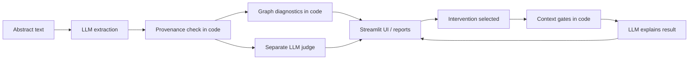

# EcoAIRE-Lite: provenance-aware causal extraction and intervention reasoning for ecology text

A small research prototype 
*NLP and Causal AI for Scientific Reasoning* (EcoAIRE project, Ref. 44/2026).
It shows how I would approach the first layer of the project: turning ecological findings into
structured, provenance-grounded, machine-actionable representations, and reasoning about how a
hypothesis holds under changed conditions.

> **Read this first**
> - All sample papers are **synthetic illustrative abstracts** written to exercise the pipeline.
>   They are not real publications, and the numbers in them are invented.
> - The language model is a hosted LLM (Groq) used zero-shot. This is a demonstration of
>   approach and engineering, **not** a validated system and not a benchmark result.
> - No model was fine-tuned for this prototype. Fine-tuning on ecology literature is part of the
>   planned PhD work (see *Roadmap*).

## What it does

| Step | Where | Done by |
|---|---|---|
| Extract hypothesis, variables, context (temperature, flow, habitat, other moderators), uncertainty, causal direction, ORKG-style triples | `src/pipeline.py` | LLM (structured JSON, Pydantic-validated, one retry) |
| Check that every provenance quote exists in the source text | `src/verification.py` | **Code** |
| DAG test, driver-to-outcome paths, qualitative net sign per path | `src/graph_analysis.py` | **Code** |
| Score causal rigor and contextual completeness | `src/pipeline.py` | **Separate** LLM call |
| Compare an intervention (temperature, flow, bank, water quality) with each edge's stated thresholds | `src/intervention.py` | **Code** |
| Explain how the intervention propagates and whether the hypothesis generalises | `src/pipeline.py` | LLM, given the code-computed gates |
| Export Markdown report and JSON-LD | `src/report_generator.py` | Code |



## Design choices

**Provenance is measured, not claimed.** The model is asked for a verbatim quote per causal edge, but
a prompt cannot guarantee it. `verify_quote` looks the quote up in the source (ignoring only
whitespace, quote/dash glyphs and letter case). Each edge becomes `exact`, `snapped` (the model
paraphrased, so it is replaced by the closest source sentence, word-level similarity >= 0.80) or
`unverified`. The reported *Provenance Faithfulness* is the share of **exact** edges, computed in code.
The judge never scores it.

**The judge is a separate call and cannot see its own prior reasoning.** It receives the source, the
extraction and the programmatic provenance result, and scores only causal rigor and contextual
completeness. The prompt contains no example scores (they would anchor the output). A judge from the
same model family can still be biased towards its own output, so the judge model is configurable
(`ECOAIRE_JUDGE_MODEL`). If the judge call fails, scores show as `n/a` instead of a made-up number.

**The simulator is not a structural causal model.** It is LLM reasoning over the extracted graph, kept
honest by a deterministic layer. Numeric boundary conditions in each edge (for example `< 0.25 m/s`,
`> 18.5°C`, `conductivity > 650 µS/cm`) are parsed and compared with the selected intervention:
`Satisfied` (inside the reported condition), `Violated` (outside), `Partial` (overlap) or
`Not testable`. These gates are given to the LLM as ground truth, and any edge verdict that contradicts
a gate is flagged in the `consistency` column. If the LLM is unreachable, the gate table is still shown.
The habitat gate is a simple keyword rule (riprap vs natural gravel/cobble bank).

**Graph checks are real graph checks.** `networkx` tests acyclicity, finds cycles, flags duplicate
cause-effect pairs and computes the product of edge signs along each driver-to-outcome path. This is
qualitative sign propagation, not a quantitative causal effect estimate.

## Run it

```bash
python -m venv .venv && source .venv/bin/activate      # Windows: .venv\Scripts\activate
pip install -r requirements.txt
cp .streamlit/secrets.toml.example .streamlit/secrets.toml   # then add your own Groq key
streamlit run app.py
```

Optional environment variables: `GROQ_API_KEY` (instead of secrets.toml), `ECOAIRE_MODEL`
(default `openai/gpt-oss-120b`), `ECOAIRE_JUDGE_MODEL` (default: same as `ECOAIRE_MODEL`),
`ECOAIRE_OFFLINE=1` (use precomputed results only).

**Offline fallback.** If the live model is unreachable, the app shows a precomputed result when one
exists. Fill the cache once with real model output (nothing in it is hand-written):

```bash
export GROQ_API_KEY=...
python scripts/build_cache.py      # writes data/precomputed_cache.json
```

Never commit `.streamlit/secrets.toml` (it is git-ignored).

## Tests

```bash
python -m pytest -q
```

36 tests, no network needed (a fake client replaces the LLM). They cover the schema, graph building,
report export, quote verification (exact, glyph/case differences, paraphrase, invented quote),
threshold parsing and context gates, path-sign logic, cycle and duplicate detection, the full
extraction pipeline (including that the judge cannot change the provenance score, retry on invalid
JSON, graceful judge failure), the simulation merge and conflict flag, and the offline cache.

## Project layout

```
app.py                      Streamlit UI
src/schema.py               Pydantic schema (context, edges, ORKG triples, evaluation)
src/pipeline.py             Prompts, extraction, judge, simulation (no Streamlit import)
src/verification.py         Provenance check
src/graph_analysis.py       DAG test and path signs
src/intervention.py         Threshold parsing and context gates
src/graph_builder.py        networkx graph and interactive pyvis rendering
src/groq_agent.py           Groq client and Streamlit caching wrapper
src/cache.py                Precomputed-result fallback
src/report_generator.py     Markdown and JSON-LD export
scripts/build_cache.py      Fill the offline cache with real model output
data/sample_papers.json     Five synthetic abstracts
tests/                      pytest suite
```

## Known limitations

- Synthetic text only; no evaluation against human-annotated ecological data.
- Single-abstract, text-only input. No figures, tables, supplementary files or datasets.
- No entity normalisation across papers; variable names are normalised by the LLM per paper.
- Threshold parsing handles simple numeric bounds and ranges (temperature, flow, conductivity,
  phosphorus). Free-text conditions are reported as `Not testable`.
- LLM judge scores are not validated against expert ratings.
- The simulator does not fit or estimate any causal model.

## Roadmap (what I would do in the project)

1. Fine-tune an open model on ecology literature for extraction, normalisation and alignment, and
   compare it with the zero-shot baseline here.
2. Extend provenance handling to full texts, figures, tables and supplementary data, across papers.
3. Replace prompt-based simulation with structural causal models learned from aligned evidence, with
   explicit interventions and uncertainty.
4. Build an expert-grounded evaluation set with ecologists and calibrate LLM-judge scores against it.
5. Align outputs with ORKG templates and publish them as reusable knowledge-graph entries.

## Related work by the author

I have previously fine-tuned an open-source model (code on my GitHub) and built and shipped a
multi-tenant RAG chatbot (FAISS and a vector database) in commercial use.

*Author: Md Shahid Afridi*
